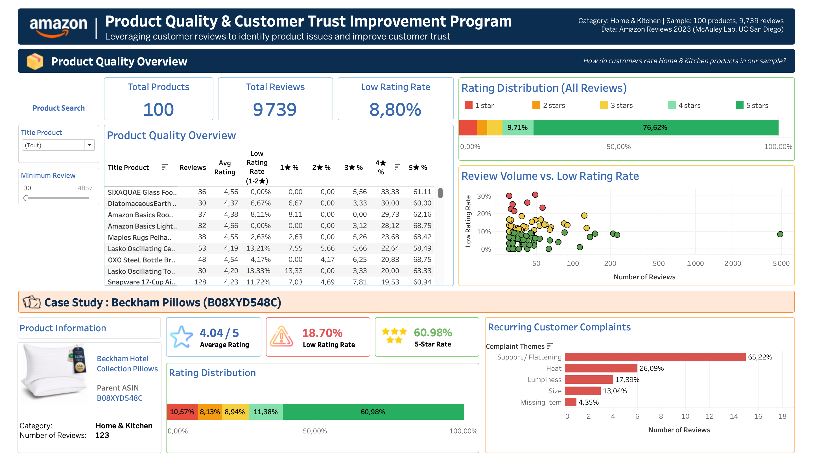

# Amazon Product Quality & Customer Trust Improvement Program

**Python | Pandas | Tableau | Customer Experience Analytics**

## Project Overview

This project analyzes Amazon customer reviews to identify potential product quality concerns, understand recurring complaints, and support data-driven improvement decisions.

Using **9,739 reviews across 100 Home & Kitchen products** from Amazon Reviews 2023, the project combines Python-based data analysis with an interactive Tableau dashboard.

## Data Collection & Preparation

The analysis uses two datasets from **Amazon Reviews 2023 (McAuley Lab, UC San Diego)**:

- **Customer Reviews:** Star ratings, review text, and product identifiers.
- **Product Metadata:** Product titles, categories, and product information.

The datasets were linked using **`parent_asin`** to associate customer feedback with product-level information.

Due to the large size of the original dataset and the scope of this individual project, the analysis focuses on **Home & Kitchen**, a category selected based on personal interest and its relevance to everyday customer experiences.

A sample of **100 products** was selected to keep the analysis manageable, retaining the available reviews associated with those products. The resulting dataset contains **9,739 reviews**.

Python and Pandas were used to clean and transform the data, calculate product-level KPIs, and prepare datasets for Tableau visualization.

**Limitation:** The findings reflect the selected sample and should not be generalized to the entire Amazon marketplace.

## Project Objectives

- Monitor customer satisfaction through ratings and review volumes.
- Identify products with elevated low-rating rates (1–2 stars).
- Analyze recurring customer complaints and potential quality concerns.
- Support data-driven prioritization and continuous improvement initiatives.

## Tableau Dashboard

The dashboard provides:

- **Product Quality Overview:** 100 products, 9,739 reviews, and an overall low-rating rate of 8.80%.
- **Product Comparison:** Review counts, average ratings, low-rating rates, and star-rating distributions.
- **Review Volume vs. Low Rating Rate:** Identification of potential quality concerns by considering both review volume and negative feedback.
- **Customer Complaint Analysis:** Detailed investigation of a selected product.

## Case Study: Beckham Hotel Collection Pillows

**Parent ASIN:** B08XYD548C

| Key Metric | Result |
|---|---:|
| Sampled Reviews | 123 |
| Average Rating | 4.04 / 5 |
| Low Rating Rate (1–2★) | 18.70% |
| 5-Star Rate | 60.98% |

### Why This Product?

Although some products have higher low-rating rates, **Beckham Hotel Collection Pillows was selected for its relatively high review volume and meaningful number of negative reviews**.

With 123 reviews, including 23 low-rated reviews, the product provides a useful sample for identifying recurring customer complaints.

This selection highlights the importance of considering **both review volume and low-rating rate**, rather than prioritizing products based on percentages alone.

### Key Findings

Despite an average rating of 4.04/5 and 60.98% five-star reviews, **18.70% of sampled reviews received 1–2 stars**.

An analysis of the 23 low-rated reviews identified the following recurring complaint themes:

| Complaint Theme | Reviews | Percentage |
|---|---:|---:|
| Support / Flattening | 15 | 65.22% |
| Heat | 6 | 26.09% |
| Lumpiness | 4 | 17.39% |
| Size | 3 | 13.04% |
| Missing Item | 1 | 4.35% |

*Percentages are calculated from the 23 low-rated reviews. Complaint categories are not mutually exclusive, as a single review may mention multiple issues.*

The most frequently identified concern relates to pillow support and flattening, suggesting an area for further investigation.

## Proposed Improvement Framework

**Identify → Investigate → Monitor → Escalate**

1. **Identify:** Prioritize products using low-rating rates, review volumes, and recurring complaints.
2. **Investigate:** Share customer feedback with relevant stakeholders to explore potential issues.
3. **Monitor:** Track new reviews, customer satisfaction, and complaint trends.
4. **Escalate:** Recommend further investigation if concerns persist.

This framework demonstrates how customer feedback analytics can support product quality monitoring and continuous improvement. It is a proposed analytical approach, not an official Amazon process.

## Tools & Skills

- **Python & Pandas:** Data cleaning, transformation, KPI calculation, and review analysis.
- **Tableau Public:** Interactive dashboards, product comparisons, and KPI visualization.
- **GitHub:** Project documentation and version control.

**Key Skills:** Data Analytics, KPI Monitoring, Customer Experience Analysis, Business Reporting, Problem Identification, and Continuous Improvement.

## Data Source

[Amazon Reviews 2023 — McAuley Lab, UC San Diego](https://amazon-reviews-2023.github.io/)

*Independent portfolio project. Findings are based on sampled customer reviews and do not confirm product defects. This project is not affiliated with or endorsed by Amazon.*
